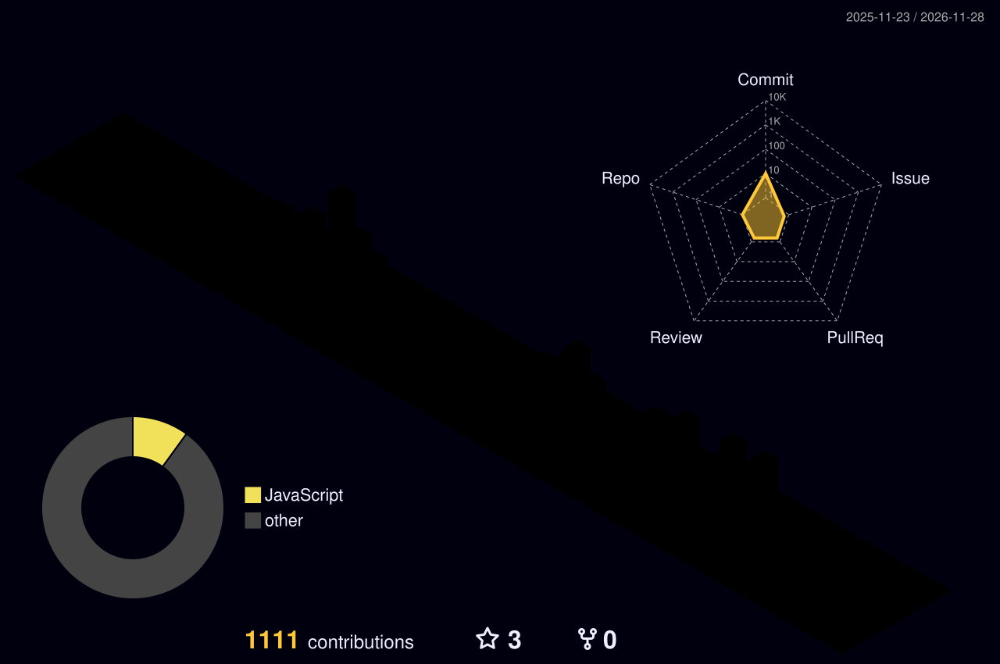

<!-- ===================== HEADER ===================== -->

  

  

  
  
  

---

<!-- ===================== ABOUT ===================== -->

### 🧑‍💻 About Me

- 🏢 Full-Stack Developer at **X4 Digital Labs**
- 🏗️ I build **multi-tenant SaaS platforms**, **HR / workforce management systems** and **e-learning platforms**
- 🌐 Backend with **Laravel, NestJS & Node.js** · Frontend with **Vue, React, Next.js & Three.js**
- ☁️ Deploying on **AWS** with **MySQL & Redis**
- 🌱 Currently exploring **Three.js & 3D web experiences**
- 📝 I write on [Medium](https://medium.com/@sanjudilshan554)
- 💬 Ask me about **Laravel, Vue, multi-tenancy**
- 📫 Reach me at **sanjudilshan554@gmail.com**

 

---

<!-- ===================== TECH STACK ===================== -->
### 🛠️ Tech Stack

**💻 Languages**

  

**🎨 Frontend & 3D**

  

**⚙️ Backend & Frameworks**

  
   
  
  
  

**🗄️ Databases & Cache**

  
   
  
  

**☁️ Cloud, DevOps & Tools**

  

**🎨 Design & Hardware**

  

---

<!-- ===================== PROJECTS ===================== -->
### 🚀 Featured Work

| Project | What it is | Built with |
|---|---|---|
| 🧭 **[Harigaman](https://harigaman.lk)** | Trip planner that builds full itineraries using free APIs | Laravel · Vue · MySQL |
| 🎓 **Fest Online Academy** | Full-stack online learning platform | NestJS · Next.js · React |
| 🏢 **Orjwan** | Multi-tenant B2B workforce platform | Laravel · Filament · Livewire · MySQL · Redis · AWS |
| 🏋️ **VYTOR Fitness** | Gym management system for Sri Lankan gyms | Laravel · Blade · MySQL |
| 📱 **Lanka Guru** | Tech-education app for Sri Lankan learners | Laravel · Vue |
| 🧱 **Laravel Multi-Tenant Boilerplate** | Reusable SaaS starter with tenant tooling | Laravel · Filament · Redis |

> ✏️ *Edit the "Built with" column if any stack differs.*

---

<!-- ===================== 3D CONTRIBUTIONS ===================== -->
### 🧊 3D Contribution Graph

  

---

<!-- ===================== STATS ===================== -->
### 📊 GitHub Stats

  
  

  

  

  

---

<!-- ===================== CONNECT ===================== -->
### 🤝 Connect With Me

  
  
  
  
  
   
  
  
  
  
  

  

